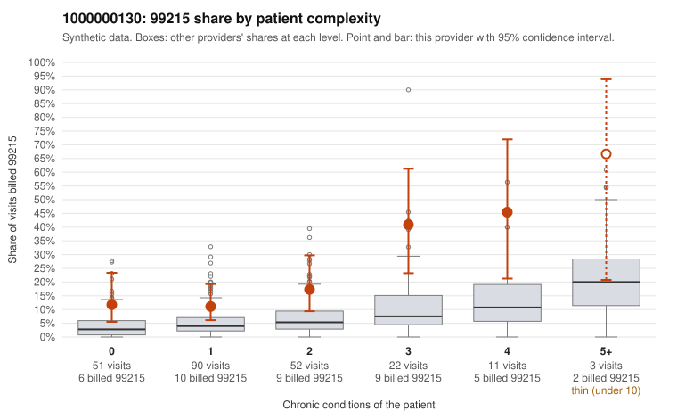

# 1000000130: 1000000130: too few returned records to judge

**Leaning (advisory):** Inconclusive

## Why

1000000130 billed 99215 on 17.9% of 229 claims against an expected 4.6% given patient complexity (risk-adjusted score 3.82; plain z-score vs peers 1.57). 39% of this provider's 99215 claims were on patients with 0 or 1 chronic conditions. Records came back for 30 claims. Of 4 documented 99215 claims, 2 (50%) were documented below the billed level, against 29% for the comparison providers. Note checks on 30 returned notes (share showing each sign): problems 33%, late 3%, unsigned 0%, data 3%. No audit trail was received. 1 of 19 notes claiming moderate-or-higher data reviewed had no lab or test line on the claim. The evidence does not support a call either way yet. Examples: C0059579: billed 99215, patient aged 62 with 1 chronic condition(s) (type 2 diabetes); documented MDM level moderate, minutes not recorded. C0059719: billed 99215, patient aged 59 with 1 chronic condition(s) (hypertension); documented MDM level moderate, 38 minutes. C0059630: billed 99215, patient aged 38 with 1 chronic condition(s) (hyperlipidemia).

## Evidence chart

## Cited claims

`C0059579`, `C0059719`, `C0059630`

## Suggested next steps

- 30 charts came back but do not settle it: request a targeted sample of 99215 charts, starting with C0059579, C0059719, C0059630.
- Re-check after the targeted charts arrive; do not call upcoding or a sicker panel on this evidence alone.

---
Citations checked: 3/3 valid. Synthetic data. The leaning is advisory; the flag comes from the statistical screen, and no clinical documentation is available beyond the sampled records-review facts shown in the packet.
