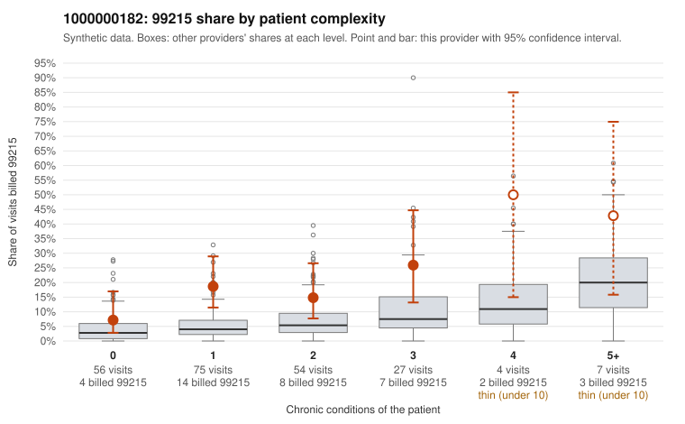

# 1000000182: 1000000182: too few returned records to judge

**Leaning (advisory):** Inconclusive

## Why

1000000182 billed 99215 on 17.0% of 223 claims against an expected 4.8% given patient complexity (risk-adjusted score 3.44; plain z-score vs peers 1.44). 47% of this provider's 99215 claims were on patients with 0 or 1 chronic conditions. Records came back for 29 claims. Of 8 documented 99215 claims, 3 (38%) were documented below the billed level, against 29% for the comparison providers. Note checks on 29 returned notes (share showing each sign): problems 34%, late 7%, unsigned 0%, data 14%. No audit trail was received. 6 of 23 notes claiming moderate-or-higher data reviewed had no lab or test line on the claim. The evidence does not support a call either way yet. Examples: C0082028: billed 99215, patient aged 28 with 1 chronic condition(s) (hyperlipidemia); documented MDM level moderate, minutes not recorded. C0082122: billed 99215; documented MDM level moderate, 37 minutes. C0082018: billed 99215, patient aged 43 with 1 chronic condition(s) (hypertension).

## Evidence chart

## Cited claims

`C0082028`, `C0082122`, `C0082018`

## Suggested next steps

- 29 charts came back but do not settle it: request a targeted sample of 99215 charts, starting with C0082028, C0082122, C0082018.
- Re-check after the targeted charts arrive; do not call upcoding or a sicker panel on this evidence alone.

---
Citations checked: 3/3 valid. Synthetic data. The leaning is advisory; the flag comes from the statistical screen, and no clinical documentation is available beyond the sampled records-review facts shown in the packet.
