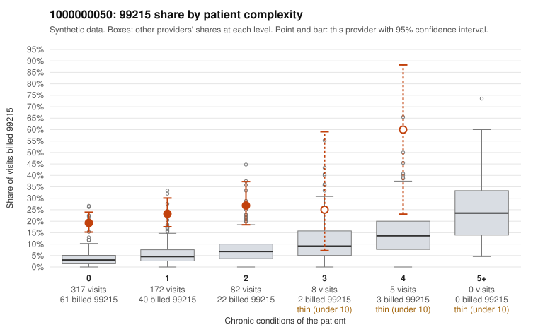

# 1000000050: 1000000050: 0 of 20 documented 99215 claims (0%) are documented below the billed level

**Leaning (advisory):** Pattern consistent with upcoding

## Why

1000000050 billed 99215 on 21.9% of 584 claims against an expected 3.9% given patient complexity (risk-adjusted score 9.25; plain z-score vs peers 2.26). 79% of this provider's 99215 claims were on patients with 0 or 1 chronic conditions. Records came back for 45 claims. Of 20 documented 99215 claims, 0 (0%) were documented below the billed level, against 22% for the comparison providers. Note checks on 45 returned notes (share showing each sign): problems 53%, late 24%, unsigned 0%, data 20%, bulk created 4%, paste heavy 4%. 10 of 32 notes claiming moderate-or-higher data reviewed had no lab or test line on the claim. This pattern is consistent with upcoding. It is a reason to review the records, not a finding. Examples: C0021725: billed 99214; documented MDM level low, minutes not recorded. C0021674: billed 99215, patient aged 35 with 1 chronic condition(s) (asthma). C0021684: billed 99215, patient aged 63 with 0 chronic condition(s). C0021780: billed 99215, patient aged 51 with 1 chronic condition(s) (chronic kidney disease).

## Evidence chart

## Cited claims

`C0021725`, `C0021674`, `C0021684`, `C0021780`

## Suggested next steps

- Request the full charts for C0021725, C0021674, C0021684 and have a certified coder re-score each against the current E/M rules (medical decision making or total time).
- If the re-scoring confirms the pattern, review the random sample in the recovery packet's sampling plan before any overpayment estimate; do not extrapolate from a targeted sample.
- Look at the notes themselves: 53% address fewer problems than their level implies and 24% were signed late; request the audit trail for C0021725, C0021674, C0021684.

---
Citations checked: 4/4 valid. Synthetic data. The leaning is advisory; the flag comes from the statistical screen, and no clinical documentation is available beyond the sampled records-review facts shown in the packet.
