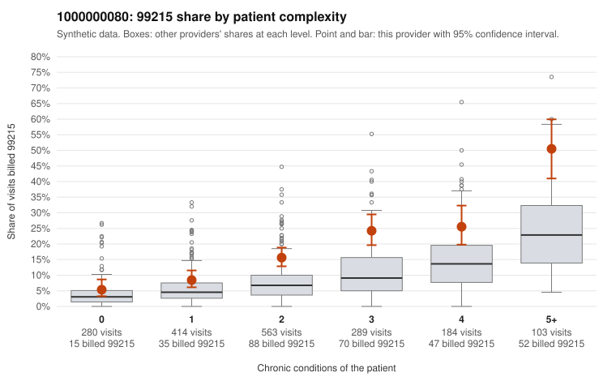

# 1000000080: 1000000080: too few returned records to judge

**Leaning (advisory):** Inconclusive

## Why

1000000080 billed 99215 on 16.7% of 1,833 claims against an expected 7.2% given patient complexity (risk-adjusted score 6.54; plain z-score vs peers 1.44). 16% of this provider's 99215 claims were on patients with 0 or 1 chronic conditions. Records came back for 30 claims. Of 6 documented 99215 claims, 2 (33%) were documented below the billed level, against 22% for the comparison providers. Note checks on 30 returned notes (share showing each sign): problems 7%, late 0%, unsigned 0%, data 0%. No audit trail was received. 0 of 19 notes claiming moderate-or-higher data reviewed had no lab or test line on the claim. The evidence does not support a call either way yet. Examples: C0031883: billed 99215; documented MDM level moderate, 35 minutes. C0032382: billed 99215; documented MDM level moderate, 31 minutes. C0031938: billed 99215, patient aged 33 with 0 chronic condition(s). C0031941: billed 99215, patient aged 62 with 0 chronic condition(s).

## Evidence chart

## Cited claims

`C0031883`, `C0032382`, `C0031938`, `C0031941`

## Suggested next steps

- 30 charts came back but do not settle it: request a targeted sample of 99215 charts, starting with C0031883, C0032382, C0031938.
- Re-check after the targeted charts arrive; do not call upcoding or a sicker panel on this evidence alone.

---
Citations checked: 4/4 valid. Synthetic data. The leaning is advisory; the flag comes from the statistical screen, and no clinical documentation is available beyond the sampled records-review facts shown in the packet.
