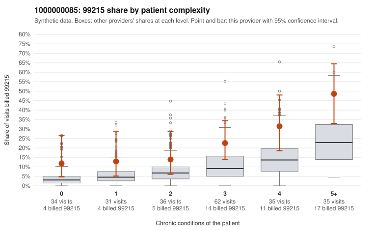

# 1000000085: 1000000085: documented 99215 claims mostly support the level billed (11% below)

**Leaning (advisory):** Pattern consistent with a high-acuity panel

## Why

1000000085 billed 99215 on 23.6% of 233 claims against an expected 9.8% given patient complexity (risk-adjusted score 2.91; plain z-score vs peers 2.53). 15% of this provider's 99215 claims were on patients with 0 or 1 chronic conditions. Records came back for 30 claims. Of 9 documented 99215 claims, 1 (11%) were documented below the billed level, against 22% for the comparison providers. Note checks on 30 returned notes (share showing each sign): problems 17%, late 7%, unsigned 0%, data 7%. No audit trail was received. 4 of 20 notes claiming moderate-or-higher data reviewed had no lab or test line on the claim. This pattern is consistent with a high-acuity panel. The sampled documentation supports the billed level. Examples: C0035786: billed 99215; documented MDM level high, 30 minutes. C0035870: billed 99215; documented MDM level high, minutes not recorded. C0035882: billed 99215; documented MDM level high, 47 minutes. C0035675: billed 99215, patient aged 96 with 5 chronic condition(s) (obesity;hypertension;atrial fibrillation;asthma;osteoarthritis). C0035729: billed 99215, patient aged 44 with 4 chronic condition(s) (type 2 diabetes;obesity;hyperlipidemia;hypertension).

## Evidence chart

## Cited claims

`C0035786`, `C0035870`, `C0035882`, `C0035675`, `C0035729`

## Suggested next steps

- Do not pursue recovery on this evidence: 30 charts came back and they support the level billed (1 of 9 documented 99215 claims below the billed level).
- Revisit if the 99215 share keeps rising against peers or a larger sample shows unsupported claims.

---
Citations checked: 5/5 valid. Synthetic data. The leaning is advisory; the flag comes from the statistical screen, and no clinical documentation is available beyond the sampled records-review facts shown in the packet.
