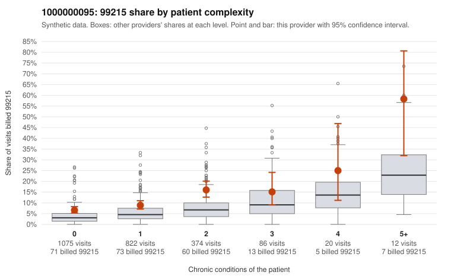

# 1000000095: 1000000095: too few returned records to judge

**Leaning (advisory):** Inconclusive

## Why

1000000095 billed 99215 on 9.6% of 2,389 claims against an expected 4.3% given patient complexity (risk-adjusted score 5.27; plain z-score vs peers 0.30). 63% of this provider's 99215 claims were on patients with 0 or 1 chronic conditions. Records came back for 12 claims. Of 2 documented 99215 claims, 0 (0%) were documented below the billed level, against 22% for the comparison providers. Note checks on 12 returned notes (share showing each sign): problems 33%, late 0%, unsigned 0%, data 0%. No audit trail was received. 0 of 8 notes claiming moderate-or-higher data reviewed had no lab or test line on the claim. The evidence does not support a call either way yet. Examples: C0041903: billed 99213; documented MDM level straightforward, minutes not recorded. C0042198: billed 99214; documented MDM level low, 21 minutes. C0041670: billed 99215, patient aged 18 with 1 chronic condition(s) (osteoarthritis). C0041683: billed 99215, patient aged 59 with 1 chronic condition(s) (atrial fibrillation).

## Evidence chart

## Cited claims

`C0041903`, `C0042198`, `C0041670`, `C0041683`

## Suggested next steps

- 12 charts came back but do not settle it: request a targeted sample of 99215 charts, starting with C0041903, C0042198, C0041670.
- Re-check after the targeted charts arrive; do not call upcoding or a sicker panel on this evidence alone.

---
Citations checked: 4/4 valid. Synthetic data. The leaning is advisory; the flag comes from the statistical screen, and no clinical documentation is available beyond the sampled records-review facts shown in the packet.
