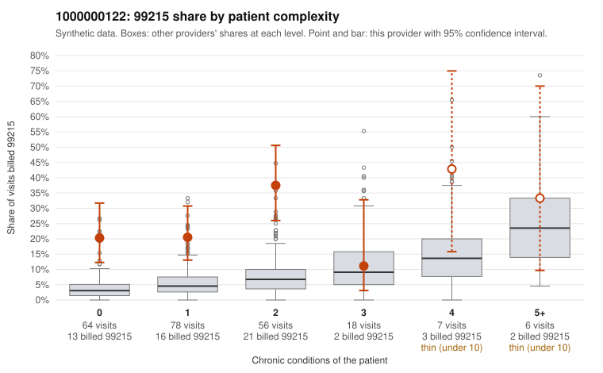

# 1000000122: 1000000122: 17 of 20 documented 99215 claims (85%) are documented below the billed level

**Leaning (advisory):** Pattern consistent with upcoding

## Why

1000000122 billed 99215 on 24.9% of 229 claims against an expected 5.4% given patient complexity (risk-adjusted score 5.36; plain z-score vs peers 2.73). 51% of this provider's 99215 claims were on patients with 0 or 1 chronic conditions. Records came back for 45 claims. Of 20 documented 99215 claims, 17 (85%) were documented below the billed level, against 22% for the comparison providers. Note checks on 45 returned notes (share showing each sign): problems 18%, late 9%, unsigned 0%, data 7%. No audit trail was received. 5 of 36 notes claiming moderate-or-higher data reviewed had no lab or test line on the claim. This pattern is consistent with upcoding. It is a reason to review the records, not a finding. Examples: C0059002: billed 99215; documented MDM level moderate, 30 minutes. C0059046: billed 99215, patient aged 44 with 0 chronic condition(s); documented MDM level moderate, minutes not recorded. C0059084: billed 99215; documented MDM level moderate, 30 minutes. C0058982: billed 99215, patient aged 28 with 1 chronic condition(s) (osteoarthritis). C0058989: billed 99215, patient aged 51 with 0 chronic condition(s). C0058992: billed 99215, patient aged 55 with 0 chronic condition(s).

## Evidence chart

## Cited claims

`C0059002`, `C0059046`, `C0059084`, `C0058982`, `C0058989`, `C0058992`

## Suggested next steps

- Request the full charts for C0059002, C0059046, C0059084 and have a certified coder re-score each against the current E/M rules (medical decision making or total time).
- If the re-scoring confirms the pattern, review the random sample in the recovery packet's sampling plan before any overpayment estimate; do not extrapolate from a targeted sample.
- Look at the notes themselves: 18% address fewer problems than their level implies and 9% were signed late; request the audit trail for C0059002, C0059046, C0059084.

---
Citations checked: 6/6 valid. Synthetic data. The leaning is advisory; the flag comes from the statistical screen, and no clinical documentation is available beyond the sampled records-review facts shown in the packet.
