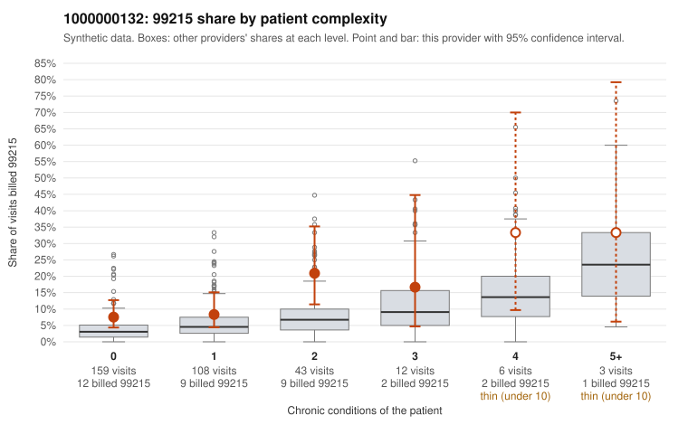

# 1000000132: 1000000132: too few returned records to judge

**Leaning (advisory):** Inconclusive

## Why

1000000132 billed 99215 on 10.6% of 331 claims against an expected 4.3% given patient complexity (risk-adjusted score 2.21; plain z-score vs peers 0.45). 60% of this provider's 99215 claims were on patients with 0 or 1 chronic conditions. Records came back for 44 claims. Of 16 documented 99215 claims, 4 (25%) were documented below the billed level, against 22% for the comparison providers. Note checks on 44 returned notes (share showing each sign): problems 46%, late 0%, unsigned 0%, data 9%, bulk created 0%, paste heavy 0%. 4 of 32 notes claiming moderate-or-higher data reviewed had no lab or test line on the claim. The evidence does not support a call either way yet. Examples: C0063009: billed 99215, patient aged 69 with 1 chronic condition(s) (depression); documented MDM level moderate, minutes not recorded. C0063022: billed 99215, patient aged 22 with 0 chronic condition(s); documented MDM level moderate, 34 minutes. C0062918: billed 99215, patient aged 46 with 1 chronic condition(s) (hyperlipidemia). C0062947: billed 99215, patient aged 34 with 0 chronic condition(s).

## Evidence chart

## Cited claims

`C0063009`, `C0063022`, `C0062918`, `C0062947`

## Suggested next steps

- 44 charts came back but do not settle it: request a targeted sample of 99215 charts, starting with C0063009, C0063022, C0062918.
- Re-check after the targeted charts arrive; do not call upcoding or a sicker panel on this evidence alone.

---
Citations checked: 4/4 valid. Synthetic data. The leaning is advisory; the flag comes from the statistical screen, and no clinical documentation is available beyond the sampled records-review facts shown in the packet.
