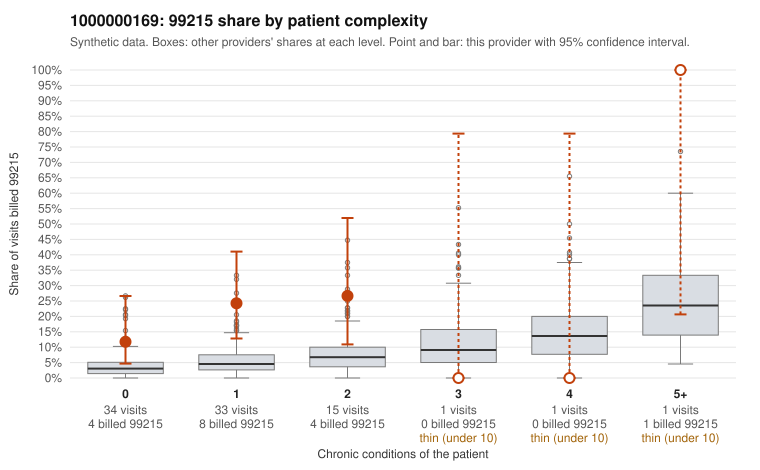

# 1000000169: 1000000169: too few returned records to judge

**Leaning (advisory):** Inconclusive

## Why

1000000169 billed 99215 on 20.0% of 85 claims against an expected 4.4% given patient complexity (risk-adjusted score 2.82; plain z-score vs peers 1.95). 71% of this provider's 99215 claims were on patients with 0 or 1 chronic conditions. Records came back for 30 claims. Of 4 documented 99215 claims, 0 (0%) were documented below the billed level, against 22% for the comparison providers. Note checks on 30 returned notes (share showing each sign): problems 37%, late 3%, unsigned 0%, data 0%, bulk created 0%, paste heavy 0%. 1 of 21 notes claiming moderate-or-higher data reviewed had no lab or test line on the claim. The evidence does not support a call either way yet. Examples: C0079262: billed 99215, patient aged 60 with 1 chronic condition(s) (hyperlipidemia). C0079266: billed 99215, patient aged 25 with 1 chronic condition(s) (hyperlipidemia); documented MDM level high, minutes not recorded.

## Evidence chart

## Cited claims

`C0079262`, `C0079266`

## Suggested next steps

- 30 charts came back but do not settle it: request a targeted sample of 99215 charts, starting with C0079262, C0079266.
- Re-check after the targeted charts arrive; do not call upcoding or a sicker panel on this evidence alone.

---
Citations checked: 2/2 valid. Synthetic data. The leaning is advisory; the flag comes from the statistical screen, and no clinical documentation is available beyond the sampled records-review facts shown in the packet.
