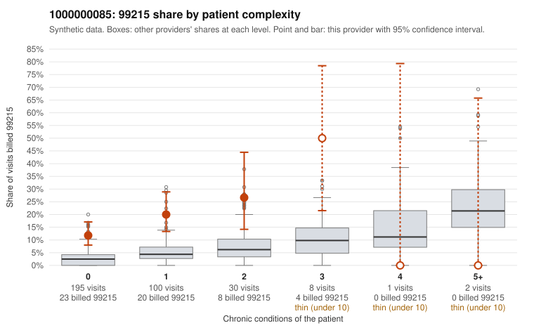

# 1000000085: 1000000085: 19 of 21 documented 99215 claims (90%) are documented below the billed level

**Leaning (advisory):** Pattern consistent with upcoding

## Why

1000000085 billed 99215 on 16.4% of 336 claims against an expected 3.6% given patient complexity (risk-adjusted score 4.59; plain z-score vs peers 1.75). 78% of this provider's 99215 claims were on patients with 0 or 1 chronic conditions. Records came back for 45 claims. Of 21 documented 99215 claims, 19 (90%) were documented below the billed level, against 48% for the comparison providers. Note checks on 45 returned notes (share showing each sign): problems 38%, late 7%, unsigned 0%, data 4%. No audit trail was received. 2 of 26 notes claiming moderate-or-higher data reviewed had no lab or test line on the claim. This pattern is consistent with upcoding. It is a reason to review the records, not a finding. Examples: C0035960: billed 99215; documented MDM level moderate, 31 minutes. C0036153: billed 99215; documented MDM level moderate, 31 minutes. C0036194: billed 99215; documented MDM level moderate, 36 minutes. C0035865: billed 99215, patient aged 43 with 0 chronic condition(s). C0035902: billed 99215, patient aged 44 with 0 chronic condition(s). C0035938: billed 99215, patient aged 57 with 1 chronic condition(s) (osteoarthritis).

## Evidence chart

## Cited claims

`C0035960`, `C0036153`, `C0036194`, `C0035865`, `C0035902`, `C0035938`

## Suggested next steps

- Request the full charts for C0035960, C0036153, C0036194 and have a certified coder re-score each against the current E/M rules (medical decision making or total time).
- If the re-scoring confirms the pattern, review the random sample in the recovery packet's sampling plan before any overpayment estimate; do not extrapolate from a targeted sample.
- Look at the notes themselves: 38% address fewer problems than their level implies and 7% were signed late; request the audit trail for C0035960, C0036153, C0036194.

---
Citations checked: 6/6 valid. Synthetic data. The leaning is advisory; the flag comes from the statistical screen, and no clinical documentation is available beyond the sampled records-review facts shown in the packet.
