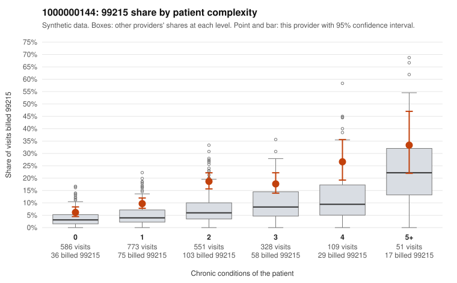

# 1000000144: 1000000144: documented 99215 claims mostly support the level billed (17% below)

**Leaning (advisory):** Pattern consistent with a high-acuity panel

## Why

1000000144 billed 99215 on 13.3% of 2,398 claims against an expected 4.9% given patient complexity (risk-adjusted score 7.33; plain z-score vs peers 1.38). 35% of this provider's 99215 claims were on patients with 0 or 1 chronic conditions. Records came back for 43 claims. Of 18 documented 99215 claims, 3 (17%) were documented below the billed level, against 50% for the comparison providers. Note checks on 43 returned notes (share showing each sign): problems 26%, late 2%, unsigned 0%, data 2%. No audit trail was received. 3 of 33 notes claiming moderate-or-higher data reviewed had no lab or test line on the claim. This pattern is consistent with a high-acuity panel. The sampled documentation supports the billed level. Examples: C0081834: billed 99215; documented MDM level high, minutes not recorded. C0082366: billed 99215; documented MDM level high, minutes not recorded. C0082792: billed 99215, patient aged 54 with 1 chronic condition(s) (chronic kidney disease); documented MDM level high, 45 minutes. C0081620: billed 99215, patient aged 57 with 4 chronic condition(s) (hypertension;heart failure;asthma;osteoarthritis). C0082059: billed 99215, patient aged 66 with 4 chronic condition(s) (type 2 diabetes;hyperlipidemia;hypertension;COPD).

## Evidence chart

## Cited claims

`C0081834`, `C0082366`, `C0082792`, `C0081620`, `C0082059`

## Suggested next steps

- Do not pursue recovery on this evidence: 43 charts came back and they support the level billed (3 of 18 documented 99215 claims below the billed level).
- Revisit if the 99215 share keeps rising against peers or a larger sample shows unsupported claims.

---
Citations checked: 5/5 valid. Synthetic data. The leaning is advisory; the flag comes from the statistical screen, and no clinical documentation is available beyond the sampled records-review facts shown in the packet.
