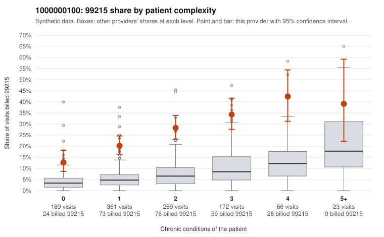

# 1000000100: 1000000100: too few returned records to judge

**Leaning (advisory):** Inconclusive

## Why

1000000100 billed 99215 on 24.9% of 1,080 claims against an expected 5.5% given patient complexity (risk-adjusted score 9.97; plain z-score vs peers 2.77). 36% of this provider's 99215 claims were on patients with 0 or 1 chronic conditions. Records came back for 45 claims. Of 25 documented 99215 claims, 4 (16%) were documented below the billed level, against 32% for the comparison providers. Note checks on 45 returned notes (share showing each sign): problems 13%, late 2%, unsigned 0%, data 2%. No audit trail was received. 4 of 39 notes claiming moderate-or-higher data reviewed had no lab or test line on the claim. The evidence does not support a call either way yet. Examples: C0049793: billed 99215, patient aged 69 with 0 chronic condition(s); documented MDM level low, minutes not recorded. C0049819: billed 99215; documented MDM level moderate, minutes not recorded. C0049480: billed 99215, patient aged 50 with 0 chronic condition(s). C0049545: billed 99215, patient aged 37 with 1 chronic condition(s) (hyperlipidemia).

## Evidence chart

## Cited claims

`C0049793`, `C0049819`, `C0049480`, `C0049545`

## Suggested next steps

- 45 charts came back but do not settle it: request a targeted sample of 99215 charts, starting with C0049793, C0049819, C0049480.
- Re-check after the targeted charts arrive; do not call upcoding or a sicker panel on this evidence alone.

---
Citations checked: 4/4 valid. Synthetic data. The leaning is advisory; the flag comes from the statistical screen, and no clinical documentation is available beyond the sampled records-review facts shown in the packet.
