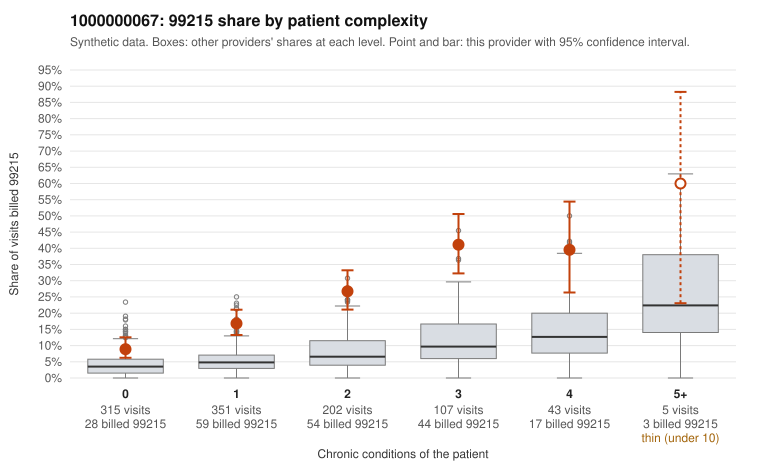

# 1000000067: 1000000067: too few returned records to judge

**Leaning (advisory):** Inconclusive

## Why

1000000067 billed 99215 on 20.0% of 1,023 claims against an expected 5.1% given patient complexity (risk-adjusted score 7.87; plain z-score vs peers 1.99). 42% of this provider's 99215 claims were on patients with 0 or 1 chronic conditions. Records came back for 44 claims. Of 24 documented 99215 claims, 1 (4%) were documented below the billed level, against 28% for the comparison providers. Note checks on 44 returned notes (share showing each sign): problems 27%, late 2%, unsigned 0%, data 7%. No audit trail was received. 5 of 36 notes claiming moderate-or-higher data reviewed had no lab or test line on the claim. The evidence does not support a call either way yet. Examples: C0040664: billed 99215; documented MDM level moderate, minutes not recorded. C0040274: billed 99215, patient aged 56 with 1 chronic condition(s) (hypertension). C0040279: billed 99215, patient aged 46 with 1 chronic condition(s) (COPD).

## Evidence chart

## Cited claims

`C0040664`, `C0040274`, `C0040279`

## Suggested next steps

- 44 charts came back but do not settle it: request a targeted sample of 99215 charts, starting with C0040664, C0040274, C0040279.
- Re-check after the targeted charts arrive; do not call upcoding or a sicker panel on this evidence alone.

---
Citations checked: 3/3 valid. Synthetic data. The leaning is advisory; the flag comes from the statistical screen, and no clinical documentation is available beyond the sampled records-review facts shown in the packet.
