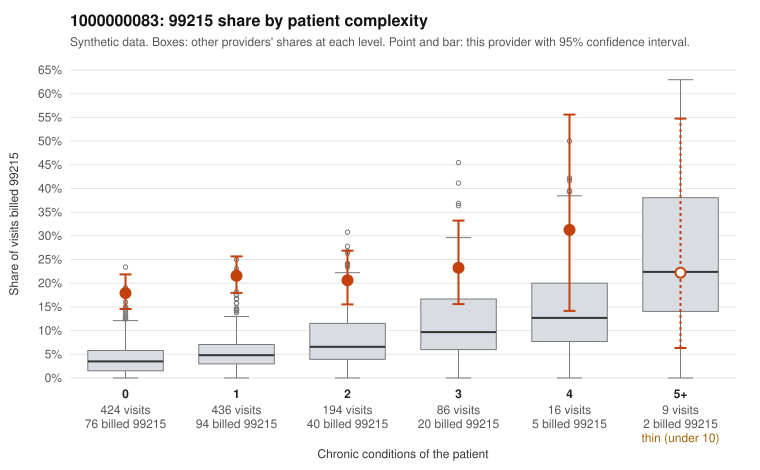

# 1000000083: 1000000083: 1 of 17 documented 99215 claims (6%) are documented below the billed level

**Leaning (advisory):** Pattern consistent with upcoding

## Why

1000000083 billed 99215 on 20.3% of 1,165 claims against an expected 4.7% given patient complexity (risk-adjusted score 9.14; plain z-score vs peers 2.04). 72% of this provider's 99215 claims were on patients with 0 or 1 chronic conditions. Records came back for 45 claims. Of 17 documented 99215 claims, 1 (6%) were documented below the billed level, against 28% for the comparison providers. Note checks on 45 returned notes (share showing each sign): problems 56%, late 20%, unsigned 0%, data 4%. No audit trail was received. 3 of 30 notes claiming moderate-or-higher data reviewed had no lab or test line on the claim. This pattern is consistent with upcoding. It is a reason to review the records, not a finding. Examples: C0056091: billed 99215; documented MDM level moderate, minutes not recorded. C0055700: billed 99215, patient aged 40 with 0 chronic condition(s). C0055741: billed 99215, patient aged 36 with 0 chronic condition(s). C0055767: billed 99215, patient aged 63 with 1 chronic condition(s) (hypertension).

## Evidence chart

## Cited claims

`C0056091`, `C0055700`, `C0055741`, `C0055767`

## Suggested next steps

- Request the full charts for C0056091, C0055700, C0055741 and have a certified coder re-score each against the current E/M rules (medical decision making or total time).
- If the re-scoring confirms the pattern, review the random sample in the recovery packet's sampling plan before any overpayment estimate; do not extrapolate from a targeted sample.
- Look at the notes themselves: 56% address fewer problems than their level implies and 20% were signed late; request the audit trail for C0056091, C0055700, C0055741.

---
Citations checked: 4/4 valid. Synthetic data. The leaning is advisory; the flag comes from the statistical screen, and no clinical documentation is available beyond the sampled records-review facts shown in the packet.
