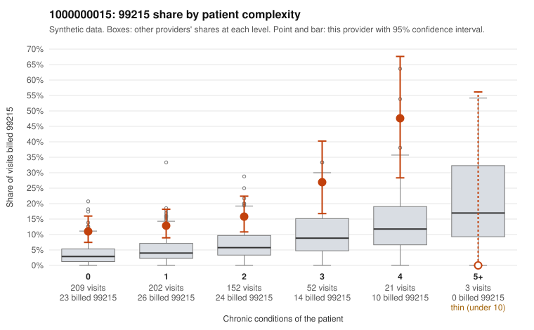

# 1000000015: 1000000015: too few returned records to judge

**Leaning (advisory):** Inconclusive

## Why

1000000015 billed 99215 on 15.2% of 639 claims against an expected 4.3% given patient complexity (risk-adjusted score 5.45; plain z-score vs peers 1.89). 51% of this provider's 99215 claims were on patients with 0 or 1 chronic conditions. Records came back for 45 claims. Of 21 documented 99215 claims, 2 (10%) were documented below the billed level, against 47% for the comparison providers. Note checks on 45 returned notes (share showing each sign): problems 42%, late 7%, unsigned 0%, data 2%. No audit trail was received. 3 of 37 notes claiming moderate-or-higher data reviewed had no lab or test line on the claim. The evidence does not support a call either way yet. Examples: C0007362: billed 99215, patient aged 50 with 0 chronic condition(s); documented MDM level moderate, 31 minutes. C0007448: billed 99215, patient aged 21 with 1 chronic condition(s) (depression); documented MDM level moderate, 36 minutes. C0007116: billed 99215, patient aged 62 with 0 chronic condition(s). C0007132: billed 99215, patient aged 22 with 0 chronic condition(s).

## Evidence chart

## Cited claims

`C0007362`, `C0007448`, `C0007116`, `C0007132`

## Suggested next steps

- 45 charts came back but do not settle it: request a targeted sample of 99215 charts, starting with C0007362, C0007448, C0007116.
- Re-check after the targeted charts arrive; do not call upcoding or a sicker panel on this evidence alone.

---
Citations checked: 4/4 valid. Synthetic data. The leaning is advisory; the flag comes from the statistical screen, and no clinical documentation is available beyond the sampled records-review facts shown in the packet.
