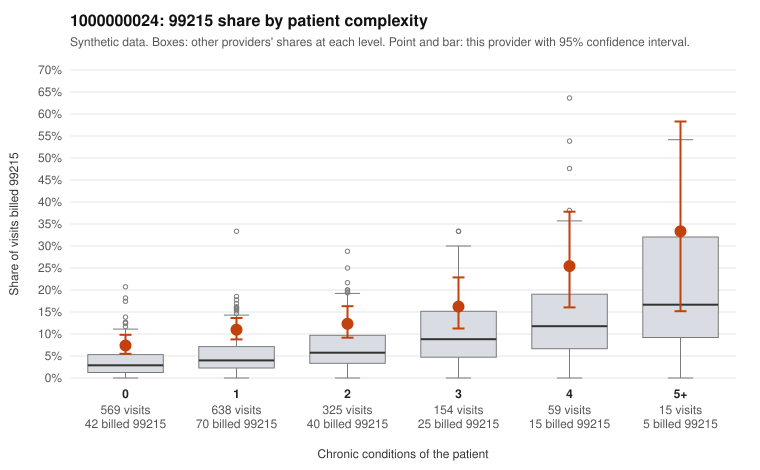

# 1000000024: 1000000024: too few returned records to judge

**Leaning (advisory):** Inconclusive

## Why

1000000024 billed 99215 on 11.2% of 1,760 claims against an expected 4.3% given patient complexity (risk-adjusted score 5.76; plain z-score vs peers 0.99). 57% of this provider's 99215 claims were on patients with 0 or 1 chronic conditions. Records came back for 25 claims. Of 10 documented 99215 claims, 4 (40%) were documented below the billed level, against 47% for the comparison providers. Note checks on 25 returned notes (share showing each sign): problems 60%, late 8%, unsigned 0%, data 0%. No audit trail was received. 3 of 20 notes claiming moderate-or-higher data reviewed had no lab or test line on the claim. The evidence does not support a call either way yet. Examples: C0011971: billed 99215; documented MDM level moderate, minutes not recorded. C0012030: billed 99215; documented MDM level moderate, minutes not recorded. C0011294: billed 99215, patient aged 56 with 1 chronic condition(s) (type 2 diabetes). C0011332: billed 99215, patient aged 54 with 1 chronic condition(s) (hypertension).

## Evidence chart

## Cited claims

`C0011971`, `C0012030`, `C0011294`, `C0011332`

## Suggested next steps

- 25 charts came back but do not settle it: request a targeted sample of 99215 charts, starting with C0011971, C0012030, C0011294.
- Re-check after the targeted charts arrive; do not call upcoding or a sicker panel on this evidence alone.

---
Citations checked: 4/4 valid. Synthetic data. The leaning is advisory; the flag comes from the statistical screen, and no clinical documentation is available beyond the sampled records-review facts shown in the packet.
