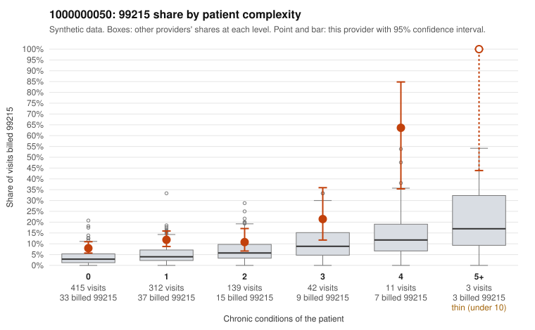

# 1000000050: 1000000050: too few returned records to judge

**Leaning (advisory):** Inconclusive

## Why

1000000050 billed 99215 on 11.3% of 922 claims against an expected 3.7% given patient complexity (risk-adjusted score 4.81; plain z-score vs peers 1.01). 67% of this provider's 99215 claims were on patients with 0 or 1 chronic conditions. Records came back for 44 claims. Of 20 documented 99215 claims, 3 (15%) were documented below the billed level, against 47% for the comparison providers. Note checks on 44 returned notes (share showing each sign): problems 43%, late 0%, unsigned 0%, data 2%. No audit trail was received. 2 of 31 notes claiming moderate-or-higher data reviewed had no lab or test line on the claim. The evidence does not support a call either way yet. Examples: C0026495: billed 99215, patient aged 82 with 4 chronic condition(s) (hypertension;COPD;osteoarthritis;chronic kidney disease); documented MDM level moderate, minutes not recorded. C0027193: billed 99215; documented MDM level moderate, minutes not recorded. C0026438: billed 99215, patient aged 72 with 0 chronic condition(s). C0026444: billed 99215, patient aged 69 with 0 chronic condition(s).

## Evidence chart

## Cited claims

`C0026495`, `C0027193`, `C0026438`, `C0026444`

## Suggested next steps

- 44 charts came back but do not settle it: request a targeted sample of 99215 charts, starting with C0026495, C0027193, C0026438.
- Re-check after the targeted charts arrive; do not call upcoding or a sicker panel on this evidence alone.

---
Citations checked: 4/4 valid. Synthetic data. The leaning is advisory; the flag comes from the statistical screen, and no clinical documentation is available beyond the sampled records-review facts shown in the packet.
