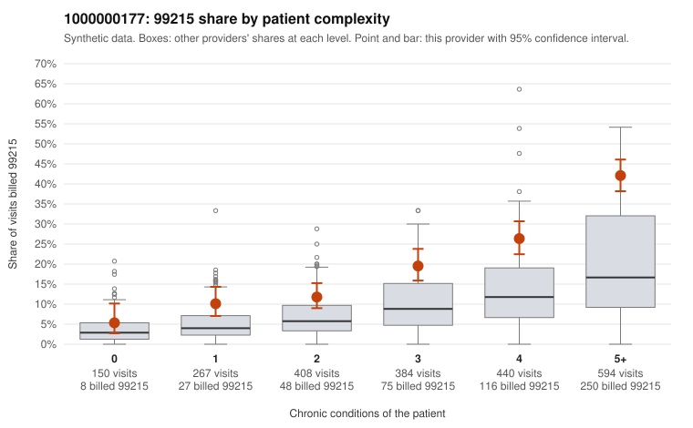

# 1000000177: 1000000177: documented 99215 claims mostly support the level billed (8% below)

**Leaning (advisory):** Pattern consistent with a high-acuity panel

## Why

1000000177 billed 99215 on 23.4% of 2,243 claims against an expected 8.4% given patient complexity (risk-adjusted score 10.42; plain z-score vs peers 3.72). 7% of this provider's 99215 claims were on patients with 0 or 1 chronic conditions. Records came back for 45 claims. Of 24 documented 99215 claims, 2 (8%) were documented below the billed level, against 47% for the comparison providers. Note checks on 45 returned notes (share showing each sign): problems 13%, late 4%, unsigned 0%, data 7%. No audit trail was received. 5 of 32 notes claiming moderate-or-higher data reviewed had no lab or test line on the claim. This pattern is consistent with a high-acuity panel. The sampled documentation supports the billed level. Examples: C0087257: billed 99215; documented MDM level high, 53 minutes. C0087521: billed 99215; documented MDM level high, minutes not recorded. C0088036: billed 99215; documented MDM level high, 43 minutes. C0087874: billed 99215, patient aged 51 with 4 chronic condition(s) (type 2 diabetes;obesity;hypertension;COPD). C0088133: billed 99215, patient aged 67 with 5 chronic condition(s) (obesity;hyperlipidemia;depression;atrial fibrillation;COPD); documented MDM level high, 42 minutes.

## Evidence chart

## Cited claims

`C0087257`, `C0087521`, `C0088036`, `C0087874`, `C0088133`

## Suggested next steps

- Do not pursue recovery on this evidence: 45 charts came back and they support the level billed (2 of 24 documented 99215 claims below the billed level).
- Revisit if the 99215 share keeps rising against peers or a larger sample shows unsupported claims.

---
Citations checked: 5/5 valid. Synthetic data. The leaning is advisory; the flag comes from the statistical screen, and no clinical documentation is available beyond the sampled records-review facts shown in the packet.
