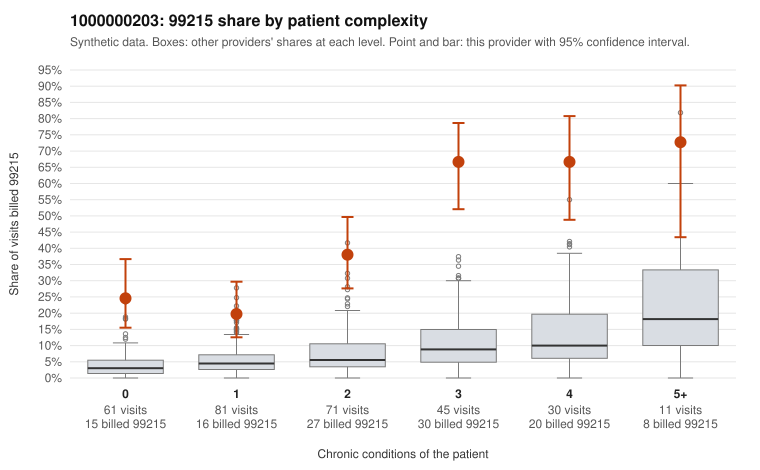

# 1000000203: 1000000203: too few returned records to judge

**Leaning (advisory):** Inconclusive

## Why

1000000203 billed 99215 on 38.8% of 299 claims against an expected 5.8% given patient complexity (risk-adjusted score 8.81; plain z-score vs peers 5.29). 27% of this provider's 99215 claims were on patients with 0 or 1 chronic conditions. Records came back for 45 claims. Of 26 documented 99215 claims, 13 (50%) were documented below the billed level, against 58% for the comparison providers. Note checks on 45 returned notes (share showing each sign): problems 16%, late 2%, unsigned 0%, data 2%. No audit trail was received. 1 of 38 notes claiming moderate-or-higher data reviewed had no lab or test line on the claim. The evidence does not support a call either way yet. Examples: C0111751: billed 99215; documented MDM level moderate, 34 minutes. C0111774: billed 99215; documented MDM level low, minutes not recorded. C0111760: billed 99215, patient aged 18 with 0 chronic condition(s). C0111784: billed 99215, patient aged 41 with 0 chronic condition(s); documented MDM level moderate, 27 minutes.

## Evidence chart

## Cited claims

`C0111751`, `C0111774`, `C0111760`, `C0111784`

## Suggested next steps

- 45 charts came back but do not settle it: request a targeted sample of 99215 charts, starting with C0111751, C0111774, C0111760.
- Re-check after the targeted charts arrive; do not call upcoding or a sicker panel on this evidence alone.

---
Citations checked: 4/4 valid. Synthetic data. The leaning is advisory; the flag comes from the statistical screen, and no clinical documentation is available beyond the sampled records-review facts shown in the packet.
