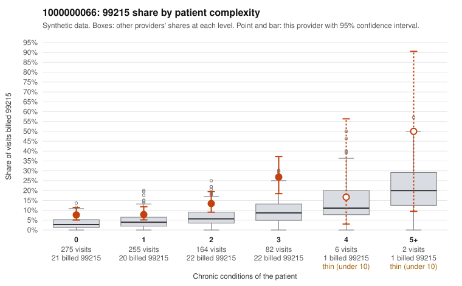

# 1000000066: 1000000066: documented 99215 claims mostly support the level billed (19% below)

**Leaning (advisory):** Pattern consistent with a high-acuity panel

## Why

1000000066 billed 99215 on 11.1% of 784 claims against an expected 4.1% given patient complexity (risk-adjusted score 4.44; plain z-score vs peers 1.00). 47% of this provider's 99215 claims were on patients with 0 or 1 chronic conditions. Records came back for 20 claims. Of 16 documented 99215 claims, 3 (19%) were documented below the billed level, against 30% for the comparison providers. Note checks on 20 returned notes (share showing each sign): problems 45%, late 0%, unsigned 0%, data 10%. No audit trail was received. 2 of 18 notes claiming moderate-or-higher data reviewed had no lab or test line on the claim. This pattern is consistent with a high-acuity panel. The sampled documentation supports the billed level. Examples: C0034410: billed 99215; documented MDM level high, 54 minutes. C0034847: billed 99215; documented MDM level high, minutes not recorded. C0034937: billed 99215; documented MDM level high, 42 minutes. C0034507: billed 99215, patient aged 74 with 5 chronic condition(s) (type 2 diabetes;hyperlipidemia;asthma;osteoarthritis;chronic kidney disease). C0034602: billed 99215, patient aged 48 with 4 chronic condition(s) (obesity;hyperlipidemia;depression;chronic kidney disease).

## Evidence chart

## Cited claims

`C0034410`, `C0034847`, `C0034937`, `C0034507`, `C0034602`

## Suggested next steps

- Do not pursue recovery on this evidence: 20 charts came back and they support the level billed (3 of 16 documented 99215 claims below the billed level).
- Revisit if the 99215 share keeps rising against peers or a larger sample shows unsupported claims.

---
Citations checked: 5/5 valid. Synthetic data. The leaning is advisory; the flag comes from the statistical screen, and no clinical documentation is available beyond the sampled records-review facts shown in the packet.
