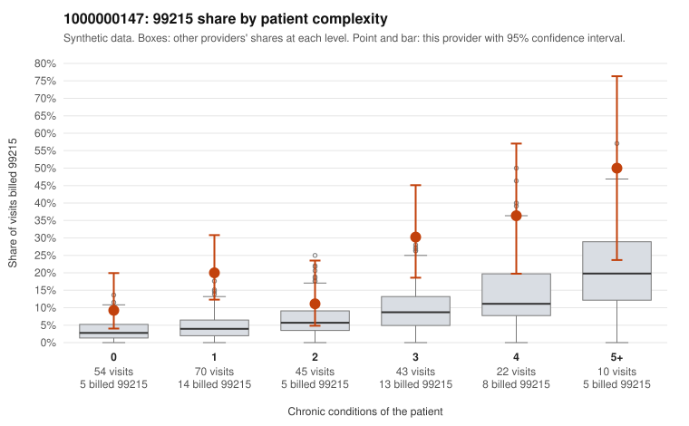

# 1000000147: 1000000147: 3 of 24 documented 99215 claims (12%) are documented below the billed level

**Leaning (advisory):** Pattern consistent with upcoding

## Why

1000000147 billed 99215 on 20.5% of 244 claims against an expected 5.6% given patient complexity (risk-adjusted score 4.57; plain z-score vs peers 3.02). 38% of this provider's 99215 claims were on patients with 0 or 1 chronic conditions. Records came back for 45 claims. Of 24 documented 99215 claims, 3 (12%) were documented below the billed level, against 30% for the comparison providers. Note checks on 45 returned notes (share showing each sign): problems 16%, late 24%, unsigned 0%, data 9%. No audit trail was received. 6 of 34 notes claiming moderate-or-higher data reviewed had no lab or test line on the claim. This pattern is consistent with upcoding. It is a reason to review the records, not a finding. Examples: C0084387: billed 99215, patient aged 59 with 5 chronic condition(s) (hypothyroidism;hyperlipidemia;heart failure;COPD;osteoarthritis); documented MDM level moderate, minutes not recorded. C0084479: billed 99215, patient aged 45 with 1 chronic condition(s) (hyperlipidemia); documented MDM level moderate, minutes not recorded. C0084491: billed 99215, patient aged 49 with 1 chronic condition(s) (obesity); documented MDM level moderate, minutes not recorded. C0084332: billed 99215, patient aged 46 with 1 chronic condition(s) (hyperlipidemia). C0084384: billed 99215, patient aged 67 with 1 chronic condition(s) (hyperlipidemia). C0084385: billed 99215, patient aged 27 with 1 chronic condition(s) (hyperlipidemia).

## Evidence chart

## Cited claims

`C0084387`, `C0084479`, `C0084491`, `C0084332`, `C0084384`, `C0084385`

## Suggested next steps

- Request the full charts for C0084387, C0084479, C0084491 and have a certified coder re-score each against the current E/M rules (medical decision making or total time).
- If the re-scoring confirms the pattern, review the random sample in the recovery packet's sampling plan before any overpayment estimate; do not extrapolate from a targeted sample.
- Look at the notes themselves: 16% address fewer problems than their level implies and 24% were signed late; request the audit trail for C0084387, C0084479, C0084491.

---
Citations checked: 6/6 valid. Synthetic data. The leaning is advisory; the flag comes from the statistical screen, and no clinical documentation is available beyond the sampled records-review facts shown in the packet.
