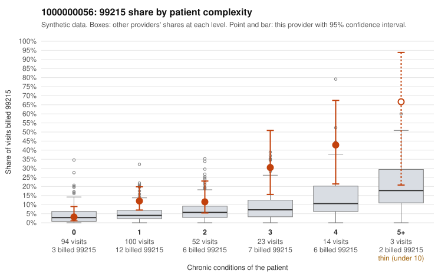

# 1000000056: 1000000056: too few returned records to judge

**Leaning (advisory):** Inconclusive

## Why

1000000056 billed 99215 on 12.6% of 286 claims against an expected 4.5% given patient complexity (risk-adjusted score 2.42; plain z-score vs peers 1.16). 42% of this provider's 99215 claims were on patients with 0 or 1 chronic conditions. Records came back for 0 claims. No documented 99215 claims came back. The evidence does not support a call either way yet. Examples: C0026991: billed 99215, patient aged 18 with 1 chronic condition(s) (hypothyroidism). C0027001: billed 99215, patient aged 57 with 1 chronic condition(s) (hypertension).

## Evidence chart

## Cited claims

`C0026991`, `C0027001`

## Suggested next steps

- No usable charts yet: request a random sample of 30 charts, then a targeted sample of 99215s for C0026991, C0027001.
- If the practice does not respond, record that non-response is not evidence of upcoding and decide whether the claims signal alone warrants more.

---
Citations checked: 2/2 valid. Synthetic data. The leaning is advisory; the flag comes from the statistical screen, and no clinical documentation is available beyond the sampled records-review facts shown in the packet.
