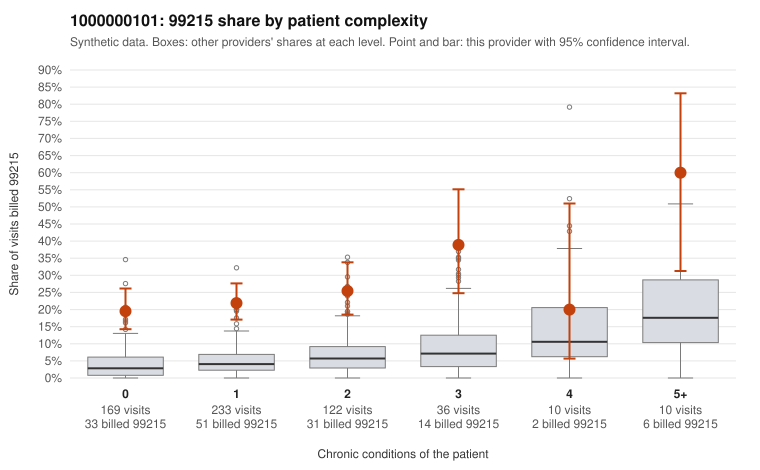

# 1000000101: Provider 1000000101 bills 99215 far above expectation, mostly on low-complexity patients, but the small documented sample supports the billed levels and also shows signs of cloned or inflated notes.

**Leaning (advisory):** Inconclusive

## Why

1000000101 billed 99215 on 23.6% of 580 claims against an expected 4.4% given patient complexity (risk-adjusted score 8.52; plain z-score vs peers 3.31). 61% of this provider's 99215 claims were on patients with 0 or 1 chronic conditions. Records came back for 45 claims. Of 19 documented 99215 claims, 1 (5%) were documented below the billed level, against 24% for the comparison providers. Note checks on 45 returned notes (share showing each sign): problems 47%, late 9%, unsigned 0%, data 24%. No audit trail was received. 11 of 41 notes claiming moderate-or-higher data reviewed had no lab or test line on the claim. The claims pattern is what upcoding looks like. The elevated 99215 share holds in every complexity band, including patients with zero or one condition, and most 99215s fall there (e.g., C0048984, C0049045, C0049104 coded only Z09). Against that, the records review found documented 99215s supported at a rate well below the comparison providers, which would normally point to a legitimately complex panel. But the panel does not look complex, and some 'supported' notes document high MDM on patients with no chronic conditions and follow-up or abdominal pain codes (C0049321, C0049434). The returned notes also show a high duplicate rate, repeated times and the data-reviewed mismatch code already flagged, all weak signs the notes may be templated to match the billed level rather than the visit. Documentation covers under a tenth of claims and no audit trail was received, so a reviewer should first request audit trails and compare the full text of the supported low-complexity 99215 notes (starting with C0049321 and C0049434) for cloning, then pull a larger records sample weighted toward 0–1 condition 99215 claims. Examples: C0048995: billed 99215; documented MDM level moderate, 33 minutes. C0048876: billed 99215, patient aged 52 with 1 chronic condition(s) (hypertension). C0048887: billed 99215, patient aged 61 with 1 chronic condition(s) (depression).

## Evidence chart

## Cited claims

`C0048995`, `C0048876`, `C0048887`

## Suggested next steps

- 45 charts came back but do not settle it: request a targeted sample of 99215 charts, starting with C0048995, C0048876, C0048887.
- Re-check after the targeted charts arrive; do not call upcoding or a sicker panel on this evidence alone.

---
Citations checked: 3/3 valid. Synthetic data. The leaning is advisory; the flag comes from the statistical screen, and no clinical documentation is available beyond the sampled records-review facts shown in the packet.
