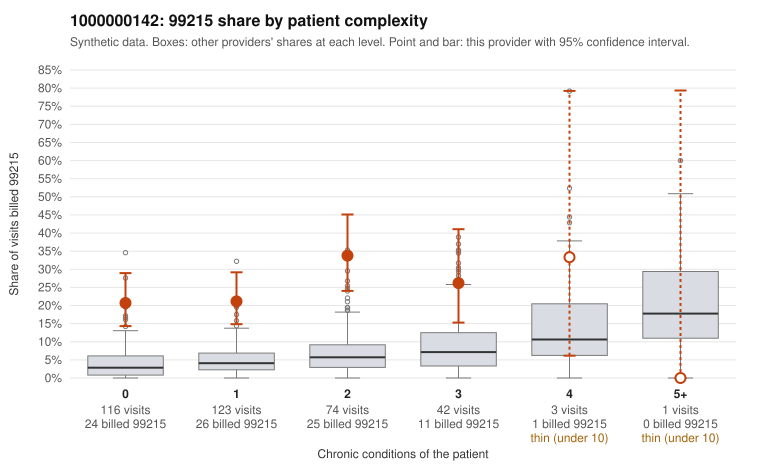

# 1000000142: 1000000142: 19 of 22 documented 99215 claims (86%) are documented below the billed level

**Leaning (advisory):** Pattern consistent with upcoding

## Why

1000000142 billed 99215 on 24.2% of 359 claims against an expected 4.3% given patient complexity (risk-adjusted score 7.00; plain z-score vs peers 3.43). 57% of this provider's 99215 claims were on patients with 0 or 1 chronic conditions. Records came back for 45 claims. Of 22 documented 99215 claims, 19 (86%) were documented below the billed level, against 24% for the comparison providers. Note checks on 45 returned notes (share showing each sign): problems 51%, late 4%, unsigned 0%, data 4%. No audit trail was received. 2 of 34 notes claiming moderate-or-higher data reviewed had no lab or test line on the claim. This pattern is consistent with upcoding. It is a reason to review the records, not a finding. Examples: C0069222: billed 99215; documented MDM level moderate, minutes not recorded. C0069253: billed 99215; documented MDM level moderate, 34 minutes. C0069351: billed 99215, patient aged 54 with 1 chronic condition(s) (atrial fibrillation); documented MDM level moderate, 39 minutes. C0069113: billed 99215, patient aged 56 with 0 chronic condition(s). C0069127: billed 99215, patient aged 68 with 0 chronic condition(s). C0069134: billed 99215, patient aged 35 with 0 chronic condition(s).

## Evidence chart

## Cited claims

`C0069222`, `C0069253`, `C0069351`, `C0069113`, `C0069127`, `C0069134`

## Suggested next steps

- Request the full charts for C0069222, C0069253, C0069351 and have a certified coder re-score each against the current E/M rules (medical decision making or total time).
- If the re-scoring confirms the pattern, review the random sample in the recovery packet's sampling plan before any overpayment estimate; do not extrapolate from a targeted sample.
- Look at the notes themselves: 51% address fewer problems than their level implies and 4% were signed late; request the audit trail for C0069222, C0069253, C0069351.

---
Citations checked: 6/6 valid. Synthetic data. The leaning is advisory; the flag comes from the statistical screen, and no clinical documentation is available beyond the sampled records-review facts shown in the packet.
