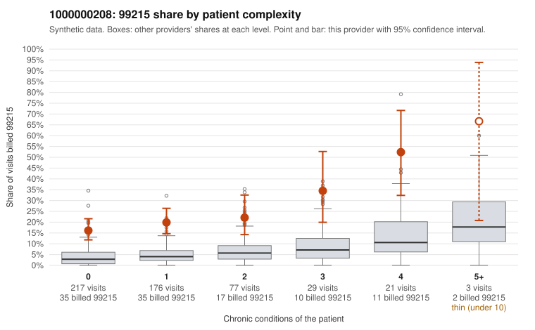

# 1000000208: Provider 1000000208 bills 99215 far above expectation, mostly on low-complexity patients, but the returned charts fully support the billed levels while showing signs of templated or inflated notes.

**Leaning (advisory):** Inconclusive

## Why

1000000208 billed 99215 on 21.0% of 523 claims against an expected 4.2% given patient complexity (risk-adjusted score 7.27; plain z-score vs peers 2.80). 64% of this provider's 99215 claims were on patients with 0 or 1 chronic conditions. Records came back for 43 claims. Of 20 documented 99215 claims, 0 (0%) were documented below the billed level, against 24% for the comparison providers. Note checks on 43 returned notes (share showing each sign): problems 37%, late 12%, unsigned 0%, data 19%. No audit trail was received. 9 of 32 notes claiming moderate-or-higher data reviewed had no lab or test line on the claim. The claims pattern looks like upcoding: 99215 use is elevated in every complexity stratum, not just among sicker patients, and sampled low-complexity 99215s carry routine diagnoses such as upper respiratory infection (C0101102, C0101238), UTI (C0101277) and follow-up visits (C0101101). The records review points the other way, with no documented 99215 falling below the billed level against a substantial all-provider mismatch rate. That level of agreement is unusually clean given normal documentation noise, and the note checks suggest the charts may be built to match the bill rather than the visit. Signs include repeated time entries, duplicate content, late notes (including supported 99215 C0101315) and moderate-or-higher data reviewed on claims with no lab or test line, though each is only weak evidence. Documentation covers only about 8% of claims and no audit trail was received, so a reviewer should first request audit logs and compare note text across the documented low-complexity 99215s to check for cloning before treating the documentation as genuine support. Examples: C0101061: billed 99215, patient aged 37 with 1 chronic condition(s) (atrial fibrillation). C0101101: billed 99215, patient aged 52 with 0 chronic condition(s).

## Evidence chart

## Cited claims

`C0101061`, `C0101101`

## Suggested next steps

- 43 charts came back but do not settle it: request a targeted sample of 99215 charts, starting with C0101061, C0101101.
- Re-check after the targeted charts arrive; do not call upcoding or a sicker panel on this evidence alone.

---
Citations checked: 2/2 valid. Synthetic data. The leaning is advisory; the flag comes from the statistical screen, and no clinical documentation is available beyond the sampled records-review facts shown in the packet.
