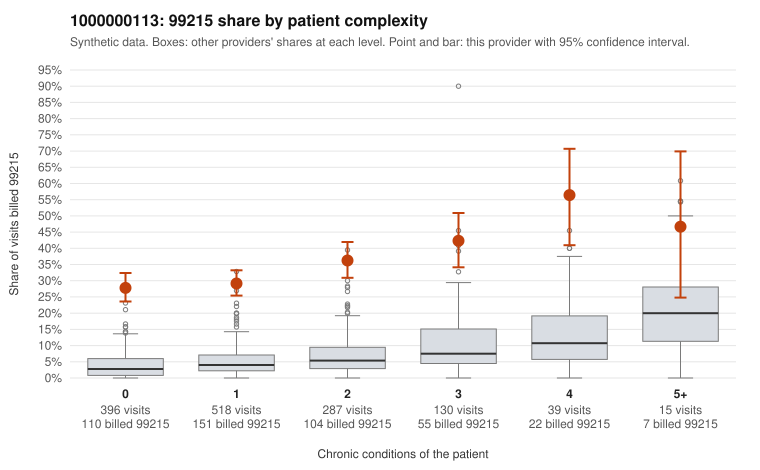

# 1000000113: 1000000113: 14 of 21 documented 99215 claims (67%) are documented below the billed level

**Leaning (advisory):** Pattern consistent with upcoding

## Why

1000000113 billed 99215 on 32.4% of 1,385 claims against an expected 4.4% given patient complexity (risk-adjusted score 21.05; plain z-score vs peers 3.73). 58% of this provider's 99215 claims were on patients with 0 or 1 chronic conditions. Records came back for 45 claims. Of 21 documented 99215 claims, 14 (67%) were documented below the billed level, against 29% for the comparison providers. Note checks on 45 returned notes (share showing each sign): problems 27%, late 4%, unsigned 0%, data 2%. No audit trail was received. 1 of 32 notes claiming moderate-or-higher data reviewed had no lab or test line on the claim. This pattern is consistent with upcoding. It is a reason to review the records, not a finding. Examples: C0052379: billed 99215; documented MDM level moderate, 38 minutes. C0052605: billed 99215; documented MDM level moderate, 30 minutes. C0052727: billed 99215, patient aged 30 with 1 chronic condition(s) (obesity); documented MDM level moderate, 34 minutes. C0052190: billed 99215, patient aged 67 with 0 chronic condition(s). C0052216: billed 99215, patient aged 60 with 0 chronic condition(s). C0052245: billed 99215, patient aged 71 with 1 chronic condition(s) (hyperlipidemia).

## Evidence chart

## Cited claims

`C0052379`, `C0052605`, `C0052727`, `C0052190`, `C0052216`, `C0052245`

## Suggested next steps

- Request the full charts for C0052379, C0052605, C0052727 and have a certified coder re-score each against the current E/M rules (medical decision making or total time).
- If the re-scoring confirms the pattern, review the random sample in the recovery packet's sampling plan before any overpayment estimate; do not extrapolate from a targeted sample.
- Look at the notes themselves: 27% address fewer problems than their level implies and 4% were signed late; request the audit trail for C0052379, C0052605, C0052727.

---
Citations checked: 6/6 valid. Synthetic data. The leaning is advisory; the flag comes from the statistical screen, and no clinical documentation is available beyond the sampled records-review facts shown in the packet.
