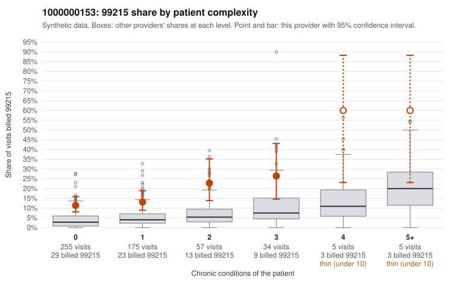

# 1000000153: 1000000153: too few returned records to judge

**Leaning (advisory):** Inconclusive

## Why

1000000153 billed 99215 on 15.1% of 531 claims against an expected 3.8% given patient complexity (risk-adjusted score 5.52; plain z-score vs peers 1.15). 65% of this provider's 99215 claims were on patients with 0 or 1 chronic conditions. Records came back for 45 claims. Of 21 documented 99215 claims, 4 (19%) were documented below the billed level, against 29% for the comparison providers. Note checks on 45 returned notes (share showing each sign): problems 49%, late 9%, unsigned 0%, data 7%. No audit trail was received. 5 of 34 notes claiming moderate-or-higher data reviewed had no lab or test line on the claim. The evidence does not support a call either way yet. Examples: C0069071: billed 99215; documented MDM level moderate, 25 minutes. C0069073: billed 99215, patient aged 64 with 1 chronic condition(s) (hypertension); documented MDM level moderate, 37 minutes. C0068933: billed 99215, patient aged 62 with 1 chronic condition(s) (obesity). C0068943: billed 99215, patient aged 33 with 0 chronic condition(s).

## Evidence chart

## Cited claims

`C0069071`, `C0069073`, `C0068933`, `C0068943`

## Suggested next steps

- 45 charts came back but do not settle it: request a targeted sample of 99215 charts, starting with C0069071, C0069073, C0068933.
- Re-check after the targeted charts arrive; do not call upcoding or a sicker panel on this evidence alone.

---
Citations checked: 4/4 valid. Synthetic data. The leaning is advisory; the flag comes from the statistical screen, and no clinical documentation is available beyond the sampled records-review facts shown in the packet.
