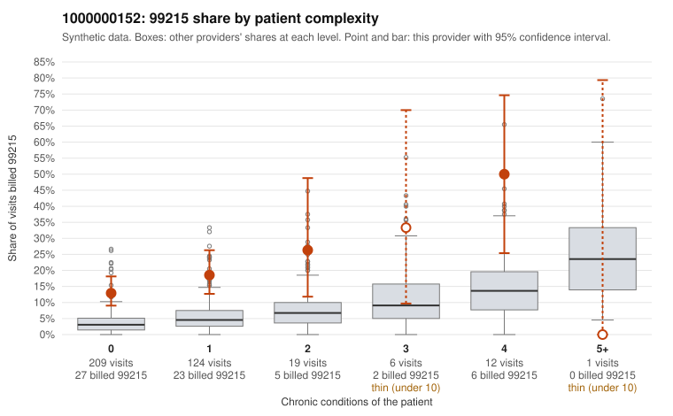

# 1000000152: 1000000152: too few returned records to judge

**Leaning (advisory):** Inconclusive

## Why

1000000152 billed 99215 on 17.0% of 371 claims against an expected 4.0% given patient complexity (risk-adjusted score 5.25; plain z-score vs peers 1.47). 79% of this provider's 99215 claims were on patients with 0 or 1 chronic conditions. Records came back for 43 claims. Of 18 documented 99215 claims, 1 (6%) were documented below the billed level, against 22% for the comparison providers. Note checks on 43 returned notes (share showing each sign): problems 49%, late 2%, unsigned 0%, data 5%. No audit trail was received. 3 of 36 notes claiming moderate-or-higher data reviewed had no lab or test line on the claim. The evidence does not support a call either way yet. Examples: C0072349: billed 99215; documented MDM level moderate, 30 minutes. C0072318: billed 99215, patient aged 46 with 0 chronic condition(s). C0072326: billed 99215, patient aged 63 with 0 chronic condition(s).

## Evidence chart

## Cited claims

`C0072349`, `C0072318`, `C0072326`

## Suggested next steps

- 43 charts came back but do not settle it: request a targeted sample of 99215 charts, starting with C0072349, C0072318, C0072326.
- Re-check after the targeted charts arrive; do not call upcoding or a sicker panel on this evidence alone.

---
Citations checked: 3/3 valid. Synthetic data. The leaning is advisory; the flag comes from the statistical screen, and no clinical documentation is available beyond the sampled records-review facts shown in the packet.
